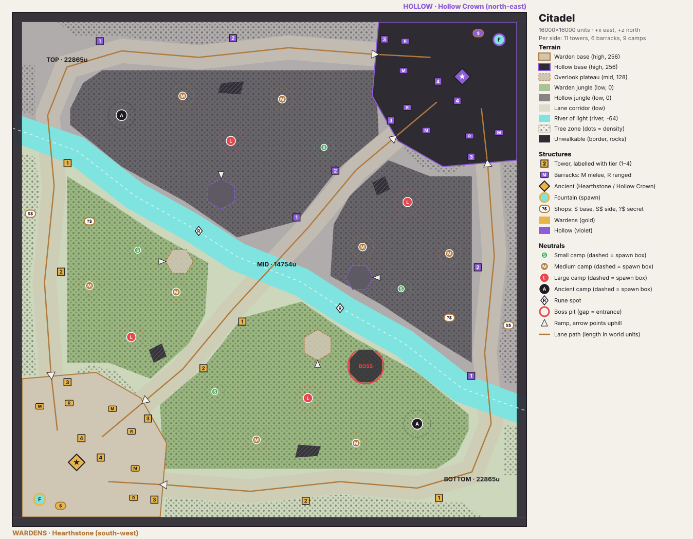

# Citadel map: layout spec (M1-04)

The battlefield is data: [`packages/content/data/map/citadel.json`](../../packages/content/data/map/citadel.json), validated by `MapSchema` in [`packages/content/src/map.ts`](../../packages/content/src/map.ts). This page explains the layout intent. The diagram below is generated from the JSON with `pnpm map:svg`. Don't edit the SVG by hand.

We follow the genre's **conventions** (square map, river between the bases, 3 lanes, 11 towers + 6 barracks + an ancient per side, jungle camps, side and secret shops, a boss pit, 2 rune spots, high-ground bases with ramps). The **geometry is our own**: the lane bends, the WNW–ESE river, the camp, shop and pit placement and every coordinate were authored for this map, not traced from any DotA map.

## Frame

| | |
|---|---|
| Size | 16000 × 16000 world units, origin at the centre |
| Axes | +x east, +z north. Angles are degrees counter-clockwise from +x (0 = east, 90 = north) |
| Wardens | South-west corner. Ancient **the Hearthstone** at (−6000, −6000), fountain at (−7150, −7150) |
| Hollow | North-east corner. Ancient **the Hollow Crown** at (6000, 6000), fountain at (7150, 7150) |
| Height levels | river −64, low 0, mid 128, high 256 (world units) |
| Symmetry | Exact **180° rotation around the centre**. Every Warden feature has a Hollow twin at (−x, −z) with facing + 180°. The validator enforces this (tolerance 25 units, 2°) |

## Lanes

All three lanes are 750 units wide and are stored as polylines from the Warden base to the Hollow base. Creeps meet first at the lane's midpoint (equal walking distance from both barracks).

| Lane | Length | River crossing (from the Warden end) | Warden role | Hollow role |
|---|---|---|---|---|
| Top | 22 865 | 9 020 | **Off lane** | **Safe lane** |
| Mid | 14 754 | 7 380 (the centre) | Mid | Mid |
| Bottom | 22 865 | 13 840 | **Safe lane** | **Off lane** |

The river is our main lever for safe and off lanes. It runs **WNW to ESE**, from (−8000, 4400) through the centre to (8000, −4400), rather than corner to corner. That means it crosses the top lane on the long western leg, *before* the lane's midpoint (11 432), and the bottom lane on the eastern leg, *after* its midpoint. So the top-lane creep meeting point sits on the Hollow side of the river, 1 231 units from the Hollow T1 and 3 136 from the Warden T1. The bottom lane mirrors this in the Wardens' favour.

- **Side lanes** bend gently (they're not ruler-straight edges), so towers and the side shops sit in natural pockets and lane-edge tree lines give juke paths.
- **Mid** is a soft S-curve through the centre, so it isn't one long sightline from tower to tower.

### Towers and barracks (arc length from the own base along the own lane)

| Tier | Safe lane | Mid | Off lane |
|---|---|---|---|
| T1 | 10 200 (1 230 short of the meeting point) | 5 585 (1 800 short of the river) | 8 300 (just before the river) |
| T2 | 6 100 | 3 700 | 5 000 |
| T3 | 1 450, on the high-ground lip | 1 450 | 1 450 |
| Barracks | melee + ranged at 800, either side of the lane | same | same |

Towers sit 480 units to the right of the lane centreline and face down the lane toward the enemy. Two **T4** towers flank the approach between the mid exit and the ancient. Each side has **11 towers, 6 barracks, 1 ancient, 1 fountain and 1 base shop**.

## Bases and high ground

Each base is a six-sided **high-ground plateau** (height `high`) covering its corner, about 4 300 units deep. Each lane leaves the base through a 900-wide **ramp** at about 1 700 units from the lane start, just outside its T3. Everything else on the base edge is cliff. The fountain, base shop and spawn points sit in the far corner, 1 600 units behind the ancient.

There are also two small **overlook plateaus** (height `mid`) per side with one 360-wide ramp each:

- **East overlook** (Warden primary jungle, by the boss pit and the east rune). It gives the owner vision over the pit entrance and the rune.
- **West overlook** (Warden secondary jungle, by the river bend near the west rune).

Under the vision rules (M2-04), low ground can't see up onto these without a ward. They're the map's main vision fights.

## Jungle

Each side has a **primary jungle** between its mid and safe lane (5 camps) and a **secondary jungle** between its mid and off lane (4 camps). That makes 9 camps per side and 18 in total.

| Tier | Per side | Where (Warden side; Hollow is rotated) |
|---|---|---|
| Small | 2 | One by the mid lane in the primary jungle (quick mid-laner farm), one near the west rune in the secondary |
| Medium | 4 | Two deep in the primary jungle near the safe lane, two in the secondary |
| Large | 2 | One in the middle of each jungle |
| Ancient | 1 | Primary jungle, by the safe-lane corner, far from the enemy |

Each camp has a **spawn box radius** (300–420). A new wave spawns only if the box is empty, which is what makes stacking work (M2-18).

**Jungle routes (Warden side; mirror for the Hollow):**

1. *Safe-lane loop:* base ramp (bottom) → medium south → large east → medium east → ancient camp → back along the safe lane. No river crossing.
2. *Mid rotation:* small east → mid T1 → river → west rune → small west. This lets mid rotate to the off lane through the secondary jungle.
3. *Gank lanes into the enemy:* the river is the shared corridor. From the west overlook you can reach the river, then the enemy primary jungle (their safe lane) over the river bend at about (−3500, 1800).

Two rocky outcrops per side (`unwalkable` regions) break up straight lines through each jungle.

## Shops

- **Base shop** beside each fountain (faction-owned).
- **Side shops** (neutral, 2): one on the **Warden off lane** at (−7440, 1736), between the Warden top T1 and T2, and its twin on the Hollow off lane at (7440, −1736). The off-laner, the most isolated hero, gets a nearby shop.
- **Secret shops** (neutral, 2): one in each secondary jungle, close to the river: (−5600, 1500) and (5600, −1500). Each side reaches its own quickly but has to walk past the river to reach the other.

## Runes and boss

- **Rune spots** sit in the river at (−2200, 1200) and (2200, −1200), about 2 500 units from the centre on either side of mid. Mid can contest either one in a few seconds. Each side lane's jungle has a short path to its nearer rune.
- **Boss pit** at (3000, −3000), radius 550. A single pit can't be point-symmetric, so the rule is that it's **equidistant from both ancients** (9 487 units each; the validator checks this). It sits on the anti-diagonal, tucked into the Warden primary jungle bank. The pit is walled except for an opening that **faces north into the river** (`entranceFacing: 90`). Both teams enter from the river: the Hollow straight across it, the Wardens by stepping out of their jungle onto the river bank first. Nobody gets a back door out of their own jungle. The Wardens' east overlook watches the entrance; the Hollow counter is the east rune and river vision. The playtest (M3-11) should check whether the pit's position favours the Wardens. If it does, move it along the anti-diagonal, or add a second Hollow-side approach.

## Tree zones

12 polygons (6 per side) with a density from 0 to 1 and a seed: map-edge forests behind each side lane, a forested fill in each jungle, and a strip along each base's lane-facing rim. Mirror pairs **share a seed**. To keep tree layouts point-symmetric too, M1-07 should scatter trees in the Warden zone and rotate them by 180° into its twin, rather than scattering each zone on its own. Foliage must stay clear of lane corridors, camp spawn boxes, ramps, rune spots, the pit, and structure footprints.

## How other work consumes this data

**Regions.** Each region is a polygon with a `tag`, a `height` level and a `faction` (biome). Where polygons overlap, precedence is **unwalkable > pit > river > base > highground > lane > jungle**. Anything not covered is open low ground. `faction` drives the Warden/Hollow biome blend across the river.

**M1-05 (terrain)** builds the heightmap from regions. It rasterises each region at its `heightLevels` elevation in precedence order, carves the riverbed along `river.waypoints` with `river.width`, and then blends:

- River ↔ low ground is a walkable sloped bank everywhere.
- Any other change of level between adjacent regions is a **cliff**, except across a `ramp`. A ramp is a `width` × `length` slope centred on `position` that rises from `from` to `to` in the `direction` of travel.
- Splat layers pick their biome from the region's `faction`, and from which side of the river a point is on for open low ground.

**M2-03 (pathing)** builds its nav grid from the same rules:

- `unwalkable` regions and cliffs block movement. Ramps and river banks connect levels. The grid stores the height level per cell.
- Tree zones become destructible tree occupancy, using the same seeded scatter as M1-07 so client and sim agree.
- Creep flow fields follow `lanes[].waypoints`, using `width` as the corridor.
- Collision footprints come from `structures[]` (positions and facing). Footprint sizes belong to the structure type data (M2-10), not the map.
- Camps (`position`, `spawnBoxRadius`), `runeSpots`, `bossPit` and `spawnPoints` feed M2-18 and the match setup.

**M2-04 (vision)** uses `height` per region for high-ground occlusion and the tree occupancy above for tree occlusion.

**M1-08 (structures)** places models from `structures[]` (type, faction, position, facing; tier picks the tower variant).

## Editing the map

1. Edit `citadel.json`. Keep every Warden feature and its Hollow twin in sync. Neutral features (river, mid lane, runes, side and secret shops) must also map onto a twin, or onto themselves.
2. Run `pnpm validate:content`. It checks the shape, bounds, tower tiers (T1–T3 per lane + 2 T4 per side), 2 barracks per lane, exactly 1 ancient and 1 fountain per side, unique ids, 180° symmetry, and the boss pit's fairness.
3. Run `pnpm map:svg` and commit the regenerated `docs/design/map-citadel.svg`. The output is deterministic.
